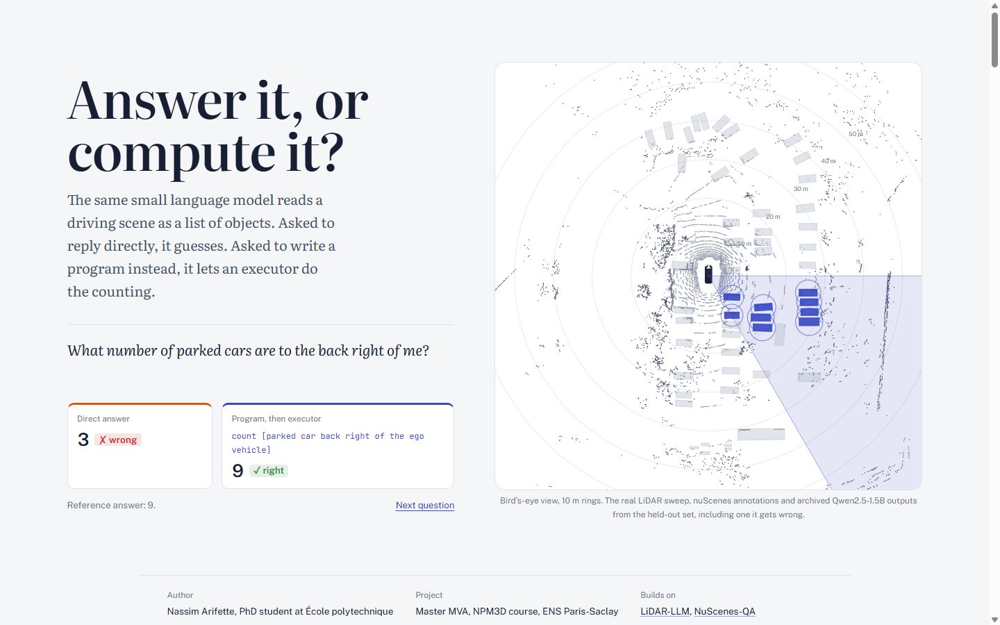

# Answer it, or compute it?

**Spatial questions about LiDAR driving scenes: should a language model answer directly, or write a program that an executor runs?**

[**Open the interactive article →**](https://nassim-arifette.github.io/lidar-llm-spatial-reasoning/)

[](https://nassim-arifette.github.io/lidar-llm-spatial-reasoning/)

[LiDAR-LLM](https://arxiv.org/abs/2312.14074) turns 3D scene understanding into text generation. This project holds perception fixed and asks a narrower question. Given the list of objects in a nuScenes scene, is the same frozen model more reliable when it **produces** the answer, or when it writes a small program that **computes** it?

## Main result

Same Qwen2.5-1.5B-Instruct checkpoint, greedy decoding, 200 evaluation questions from three drives never seen during development:

| | Direct answer | Program + executor |
|---|---:|---:|
| Accuracy | 50.5 % | **68.5 %** |
| Questions answered | 100 % | 91 % |
| Counting error (MAE) | 2.16 | **0.68** |

Refusals and invalid programs count as wrong. The gain is positive on each evaluation drive (+21.2, +18.8 and +13.8 points). On 13 questions repeated verbatim across scenes with different answers, the executed mode is right everywhere in 13 of 13; the direct mode in 1.

| Model | Direct | Executed |
|---|---:|---:|
| Qwen2.5 1.5B (local, fp16) | 50.5 % | 68.5 % |
| Qwen2.5 7B (local, fp16) | 50.5 % | 82.5 % |
| Qwen2.5 32B (local, int4) | 58.0 % | 84.5 % |
| Qwen3 32B (hosted) | 56.0 % | 84.0 % |
| Qwen3-Next 80B, 3B active (hosted) | 61.0 % | 84.5 % |
| Qwen3.8 27B (hosted) | 84.0 % | 84.5 % |

The last row is a counterexample to a universal execution advantage. It is not proof that "reasoning" rather than scale explains the change: the endpoints differ in architecture, training and output budget.

## What you can do on the site

| Figure | Try this |
| --- | --- |
| What the model is given | Browse the 102 evaluation keyframes in bird's-eye view or 3D, over the real LiDAR sweep, next to the exact prompt rows. Switch to "LiDAR returns" to see annotated objects the sensor never hit. |
| Directions are a convention | Click any object to measure the six 60° NuScenes-QA sectors from it. |
| Writing a program | Build a program in the study's JSON schema and run it live on any scene, refusals included. |
| 200 questions, two answers | Every archived answer of all six models, filtered by which method was right, with the scene of each question. |
| Counting, scene dependence, scale | Where the gain comes from, and where it disappears. |

The site re-runs the archived programs with a TypeScript port of the executor. A test checks that it reproduces every saved answer and every selected object for the six models.

## Verify the results without a GPU

```bash
python -m pip install -r requirements-audit.txt
python -m spatial_reasoning.audit_results
```

The audit recomputes correctness and every summary field from **1,580 per-question records in eight comparisons**, checks manifest membership and scene separation, and fails on any disagreement. The [audit receipt](spatial_reasoning/results/artifact_audit.json) records file hashes. The CPU test suite runs with the command below; the last local run passed 203 tests with three optional skips, and the modules that need PyTorch were not run.

```bash
python -m pip install -r requirements-test.txt
python -m pytest tests/ -q
```

GPU reruns, the metadata download, cache handling and the two unfinished extensions are described in [`docs/REPRODUCIBILITY.md`](docs/REPRODUCIBILITY.md).

## Scope and limits

- **Perception is an oracle.** Object lists and statuses are nuScenes ground-truth annotations. No detector was run.
- **Three drives are not a population.** Questions within a drive are correlated; the sign test is descriptive.
- **Program execution is not new.** CLEVR and Neural-Symbolic VQA did it first. The contribution is an auditable, same-checkpoint comparison on driving questions, with scene-disjoint splits and failure traces.
- **A wider language can lose.** On 280 broader questions, a typed CLEVR-style language covers 98.5 % of the benchmark, but at 1.5B it answers only 34.6 % of questions and reaches 29.6 % accuracy, against 52.1 % for the direct answer.
- **Labels and input can disagree.** 4,278 of 18,538 annotated objects in the processed mini split have zero LiDAR returns; NuScenes-QA still counts them.

More in [`docs/LITERATURE.md`](docs/LITERATURE.md) and the [report](report/rapport_npm3d.pdf).

## Repository layout

| Path | Role |
| --- | --- |
| `spatial_reasoning/` | Frozen-model comparison, parsing, geometry and program execution |
| `spatial_reasoning/manifests/` | Frozen question sets and exclusions |
| `spatial_reasoning/results/` | Saved answers, programs, summaries and diagnostics |
| `tests/` | Protocol, parser, executor and runtime checks |
| `report/` | LaTeX report and compiled PDF |
| `web/` | Source of the website (Vite + TypeScript, D3, Three.js). See [`docs/SITE.md`](docs/SITE.md) |
| `tools/` | Data and LiDAR export for the site, link checks |
| `models/`, `training/`, `distillation/`, `data/`, `evaluation/`, `inference/` | Original 2025 course prototype |

To work on the site: `cd web && npm ci && npm run dev`. GitHub Actions tests, builds and publishes it on every push to `main`.

## History and credits

The original two-person NPM3D course project was forked from [`oomcth/npm-3D`](https://github.com/oomcth/npm-3D). It connected a reduced PointNet/VAT/GPT-2 pipeline but never completed a real training run; that code is kept and clearly separated from the revised study. Scenes come from [nuScenes](https://www.nuscenes.org/) v1.0-mini (CC BY-NC-SA 4.0) and questions from [NuScenes-QA](https://arxiv.org/abs/2305.14836).

Nassim Arifette, PhD student at École polytechnique. Master MVA, ENS Paris-Saclay.
